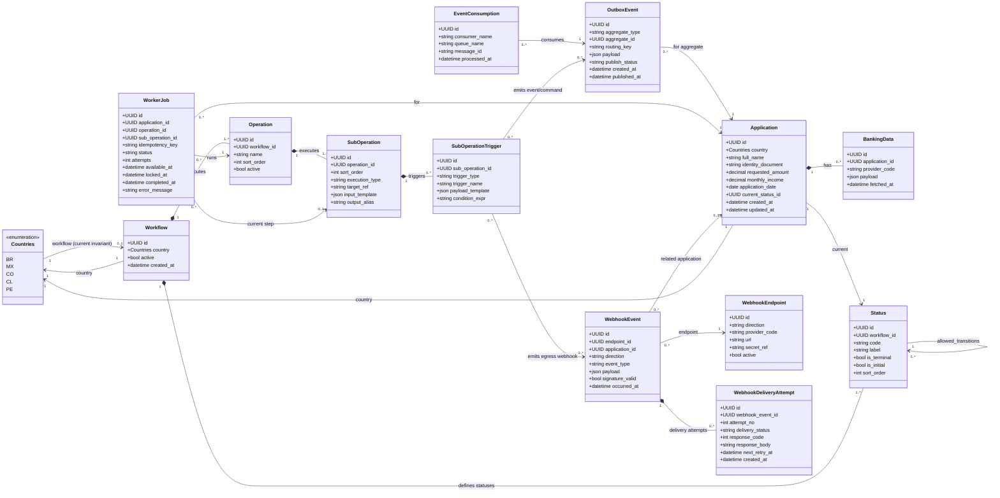

# Architecture Specification and Technology Stack

## Metadata
- Product: `credit-applications-hub`
- Status: Draft
- Last Updated: 2026-02-14
- Author: Engineering

## Overview
This document defines the MVP architecture and technology stack for the credit applications hub. The system is split into app-level entrypoints (`apps/`) and domain-oriented business logic (`src/`) using DDD + Hexagonal boundaries.

## Architecture Principles
- Keep transport and framework code in `apps/`.
- Keep business capabilities in bounded contexts under `src/`.
- Use domain events and async commands for cross-module/process communication.
- Prefer exchange-per-domain/context and queue-per-consumer/use-case.
- Keep consumers idempotent and safe for parallel processing.

## Application Specifications

### 1) Backend (`apps/backend`) - FastAPI
Responsibilities:
- Expose REST APIs for creating, reading, listing, and updating applications.
- Execute synchronous validations and orchestration for immediate request flows.
- Persist source-of-truth application data in PostgreSQL.
- Publish integration events to RabbitMQ after relevant domain changes.
- Expose near-real-time update channel to frontend via WebSocket/Socket.IO-style push.

### 2) Frontend (`apps/frontend`) - Vue.js
Responsibilities:
- Provide create/list/detail/update status experiences.
- Filter lists by country and status.
- Subscribe to near-real-time updates (WebSocket/Socket.IO-style push) and refresh state within seconds.
- Show processing state transitions driven by backend events/projections.
- Use `shadcn-vue` as the main UI component library for all new frontend screens/components.
- Keep design tokens and component conventions aligned with `shadcn-vue`.
- Reference installation baseline: official `shadcn-vue` installation documentation.

### 3) Webhooks (`apps/webhooks`) - FastAPI
Responsibilities:
- Handle inbound webhooks from external providers.
- Validate signatures/authentication for inbound calls.
- Normalize payloads and publish internal events/commands.
- Subscribe to egress events when outbound webhook delivery is needed.
- Track webhook delivery attempts, retries, and dead-letter outcomes.
- Persist webhook endpoint configuration and event/audit records.

### 4) Workers (`apps/async_tasks`) - Event Subscribers / Command Runners
Responsibilities:
- Subscribe to RabbitMQ queues per use case.
- Execute background workflows (provider sync, risk checks, notifications, status recalculation).
- Run handlers in parallel with idempotency protections.
- Emit follow-up events for downstream consumers and UI projections.
- Persist job state transitions and consumer idempotency checkpoints.

## Technology Stack
- API Framework: FastAPI (backend + webhooks)
- Frontend Framework: Vue.js
- Message Broker: RabbitMQ
- Primary Database: PostgreSQL
- Cache/Rate Control: Redis

## Data Model (Starting Point)
The diagram below uses your base classes (`Application`, `BankingData`, `Status`, `Workflow`, `Operation`, `Countries`) and adds webhook/worker models required for complete async and integration flows.

### Current Invariants (MVP)
- Only one `Workflow` is allowed per country (`Countries`) value for now; no country can have more than one workflow.
- Exactly one `Status` row must have `is_initial=true` per `Workflow`.
- Multiple `Operation` rows can belong to the same `Workflow`.
- Each `Operation` can have multiple ordered `SubOperation` rows.
- `Application.country` must match the `Workflow.country` used for status resolution.
- `Application.current_status_id` is initialized from `Status(is_initial=true)` of the matched country workflow.
- Valid next statuses are defined by the `Status -> Status` `allowed_transitions` relation within the same workflow.
- Terminal statuses (`is_terminal=true`) must have zero outgoing `allowed_transitions` relations.

### Model Clarifications
- `WebhookEndpoint.country` is required. Each endpoint is configured for exactly one country.
- `OutboxEvent` is the durable integration-event record created in the same DB transaction as domain changes; a publisher process reads pending outbox rows and sends them to RabbitMQ.
- `EventConsumption` is the consumer-side idempotency/audit record; it stores processed message IDs per consumer/queue to prevent duplicate side effects.
- `allowed_transitions` is modeled as a self-relation on `Status`; in persistence it can be represented by a join table (`status_transition`) with `from_status_id` and `to_status_id`.
- `SubOperation.execution_type` supports the current operation types:
  - `QUERY_USE_CASE`
  - `COMMAND_USE_CASE`
  - `THIRD_PARTY_HTTP_REQUEST`
- `SubOperationTrigger` allows using prior sub-operation outputs (`output_alias`) to trigger:
  - new events (`TRIGGER_EVENT`)
  - new commands (`TRIGGER_COMMAND`)
  - webhook egress (`TRIGGER_WEBHOOK_EGRESS`)

### Ownership and Write Paths
- Backend writes: `Application`, `BankingData`, `Workflow`/`Status`/`Operation`/`SubOperation`/`SubOperationTrigger` metadata, `OutboxEvent`, and read projections.
- Workers write: `WorkerJob` and `EventConsumption`. If async logic requires status changes, workers emit commands/events and the backend application service applies the `Application` transition (single writer rule).
- Webhooks write: `WebhookEndpoint` config, `WebhookEvent`, and `WebhookDeliveryAttempt`. Webhooks do not write `Application` state directly; they publish normalized events/commands.
- Frontend reads backend projections/materialized views only (no direct table writes).

## Data and Messaging Specifications

### PostgreSQL
Use as system of record for:
- Applications
- Status history / audit trail
- Provider snapshots/references
- Workflow and operation definitions
- Job correlation and idempotency metadata
- Outbox events
- Webhook endpoint/event/delivery records

Recommended patterns:
- Transaction boundaries around state changes.
- Outbox table for reliable event publication.
- Optimistic locking/version fields for race-safe status updates.
- Enforce one-workflow-per-country with a unique constraint/index on `workflow.country`.
- Enforce one-initial-status-per-workflow with a unique partial index on `status(workflow_id)` where `is_initial=true`.
- If using a join table for the self-relation, enforce unique transition edges with a unique index on `status_transition(from_status_id, to_status_id)`.

### RabbitMQ
Use for:
- Integration events between apps and bounded contexts.
- Async commands consumed by workers.

Topology guideline:
- Exchange per domain/context (for example `applications.events`).
- Queue per consumer/use case (for example `workers.provider_sync.q`, `webhooks.egress.q`).
- Routing keys per event/command type.
- Per-queue retry, DLQ, TTL, and prefetch policies.

### Redis
Use for:
- Read-model caching for frequently queried lists/details.
- Request throttling and anti-abuse controls.
- Short-lived distributed locks/idempotency keys for workers.

## End-to-End Flow (MVP)
1. Frontend submits application to backend.
2. Backend validates country rules, resolves initial status from `Status(is_initial=true)`, and persists application in PostgreSQL.
3. Backend persists an outbox integration event and the publisher dispatches it to RabbitMQ (event contract names/versioning are defined separately).
4. Workers consume events/commands, run async business commands, and publish follow-up events/commands.
5. Backend is the single writer for `Application` state and read projections; webhooks/workers send events/commands that backend handlers apply.
6. Frontend receives near-real-time updates and refreshes application status.

## Webhook Flows (Target MVP Design)
### Ingress (Provider -> Platform)
1. Provider sends webhook to `apps/webhooks`.
2. Webhooks app verifies signature and stores `WebhookEvent` (`direction=INGRESS`).
3. Webhooks app publishes normalized event/command to RabbitMQ.
4. Workers/backend consumers process the event; only backend application handlers update `Application`, while workers update `WorkerJob`/side-effect state.
5. Backend emits status update to frontend channel.

### Egress (Platform -> Provider)
1. Backend/workers create domain event and persist `OutboxEvent`.
2. Publisher pushes event to RabbitMQ with routing key.
3. Webhooks egress subscriber consumes event, resolves `WebhookEndpoint`, and sends request.
4. Webhooks app stores `WebhookDeliveryAttempt`; retries and DLQ are applied per queue policy.
5. Final delivery status is persisted to `WebhookEvent`/audit records.

## Cross-Cutting Requirements
- Security: authN/authZ at API and webhook edges, signed webhook verification.
- Reliability: at-least-once delivery assumptions, idempotent handlers, DLQ monitoring.
- Observability: correlation IDs, structured logs, queue/consumer metrics, tracing.
- Scalability: horizontal scale for backend/webhooks/workers; independent queue scaling.

## Suggested Initial Queue Map
- `workers.application_created.q`
- `workers.status_changed.q`
- `workers.provider_sync.q`
- `webhooks.egress_delivery.q`
- `backend.projections_refresh.q` (optional, if projection worker is separated)

## Open Decisions
- Outbox implementation details and polling/publish mechanism.
- Exact country/provider strategy contract and versioning policy.
- Redis deployment mode (single node vs highly available).
- WebSocket/Socket.IO channel fan-out strategy for multi-instance backend deployments.
